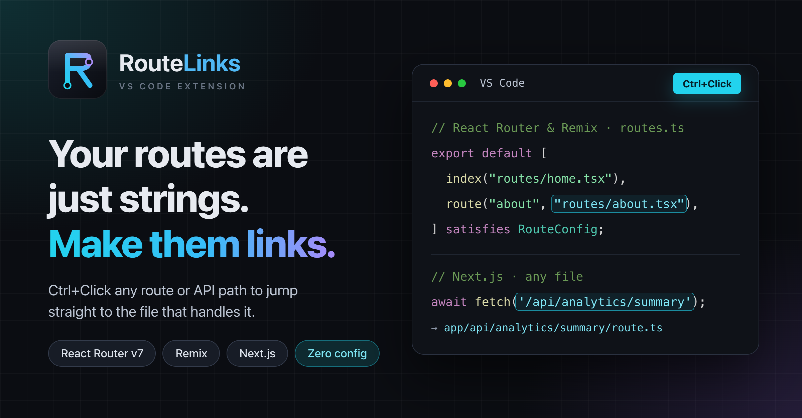

# RouteLinks — React Router, Remix & Next.js

Makes route file paths **and** API route strings in React Router v7+, Remix
and Next.js projects clickable in VS Code — Ctrl+Click any of them to jump
straight to the file that handles it.

[](https://marketplace.visualstudio.com/items?itemName=anparasan.routelinks)
[](https://marketplace.visualstudio.com/items?itemName=anparasan.routelinks)
[](https://marketplace.visualstudio.com/items?itemName=anparasan.routelinks)





## The problem

VS Code's TypeScript server only supports go-to-definition on real `import`
statements. But in a React Router v7+ `routes.ts` config, route modules are
referenced as plain strings:

```ts
import { type RouteConfig, index, route } from "@react-router/dev/routes";

export default [
  index("routes/home.tsx"),
  route("about", "routes/about.tsx"),
] satisfies RouteConfig;
```

Those strings are inert to VS Code — no Ctrl+Click, no quick navigation.
Every time you want to check what `"routes/home.tsx"` actually renders, you're
manually hunting through folders.

## What this extension does

It turns those route path strings into real, clickable links.

Hover over `"routes/home.tsx"` and it underlines like a link. Ctrl+Click
(Cmd+Click on macOS) opens the file directly — no manual searching, no
breaking your flow to go dig through the file tree.

It also works the other way: in *any* `.ts`/`.js`/`.tsx`/`.jsx` file, a
string like `"/api/someroute/:someId/some"` becomes clickable too, as long as
that path is actually defined in `routes.ts` (including nested `route()`,
`index()`, `layout()`, and `prefix()` calls) — Ctrl+Click jumps straight to
the module that handles it.

### Next.js

In a Next.js project, the same API and page strings link to their files, with
no config:

```ts
const res = await fetch('/api/analytics/summary');
// Ctrl+Click → app/api/analytics/summary/route.ts
```

- **App Router:** `route.*` and `page.*` files under `app/` or `src/app/`.
  Dynamic `[id]`, catch-all `[...slug]` and optional `[[...slug]]` segments,
  route groups `(group)` and parallel slots `@slot` are all supported.
- **Pages Router:** files under `pages/` or `src/pages/`, including
  `index` files and `pages/api/*`.
- Static routes win over dynamic ones, so `/api/users/me` opens
  `users/me/route.ts` rather than `users/[id]/route.ts`.
- Query strings and hashes are ignored (`/api/x?range=7d` still links).
- Monorepos work: any folder with a `next.config.*` is treated as a Next.js app.

## Install

Search **"RouteLinks"** in the VS Code Extensions panel, or:

```bash
code --install-extension anparasan.routelinks
```

## Features

- Works automatically in `routes.ts` / `routes.js` / `routes.tsx` / `routes.jsx`
- Resolves paths relative to the routes file's own directory (the `app/` dir),
  with fallbacks to the workspace root, `app/`, and `src/`
- Also links matching route/API path strings (e.g. `/api/users/:id`) found in
  *any* `.ts`/`.js`/`.tsx`/`.jsx` file back to the route module that handles them
- Only links to files that actually exist — a typo'd path simply won't
  underline, doubling as a lightweight sanity check
- Zero runtime dependencies, lightweight

## Settings

Customize which files and extensions are treated as route links via
`Settings → Extensions → RouteLinks`, or in `settings.json`:

| Setting | Default | Description |
|---|---|---|
| `reactRouterRouteLinks.fileNames` | `routes.ts`, `routes.js`, `routes.tsx`, `routes.jsx` | Which files get link treatment |
| `reactRouterRouteLinks.extensions` | `.tsx`, `.ts`, `.jsx`, `.js`, `.mdx`, `.md` | String suffixes treated as route paths |

## FAQ

**Does it work with Remix?**  
Yes. Remix uses the same `routes.ts` config format, so route and API path
strings are clickable there too.

**Does it work with Next.js?**  
Yes. API and page path strings link to the matching `app/` or `pages/` file.
A folder is treated as a Next.js app when it has a `next.config.*` file.

**Does it work with React Router v6?**  
The clickable-`routes.ts` feature targets the React Router v7 / Remix config
format. Older file-based routing conventions are not resolved.

**Do I need a specific folder layout?**  
No. Paths resolve relative to the `routes.ts` file first, then the workspace
root, `app/`, `src/app/`, and `src/`. If the config lives somewhere unusual,
the extension searches the workspace for it.

**Does it slow down VS Code?**  
No. There are no file watchers or runtime dependencies. The routes config is
parsed once and cached until it changes on disk. Next.js route files are
scanned on demand and cached for 30 seconds, and the cache refreshes right away
when you add, delete or rename a file in VS Code.

**Will it link dynamic template literals?**  
No. Values like `/users/${id}` aren't statically known, so they're skipped.
Static strings are linked normally.

## Found a bug or have a request?

Open an issue on [GitHub](https://github.com/Anparasan3/route-links/issues).

## License

MIT © Anparasan T

Next.js is a trademark of Vercel, Inc. React Router and Remix are trademarks
of Shopify Inc. RouteLinks is an independent project and is not affiliated with
or endorsed by either company.